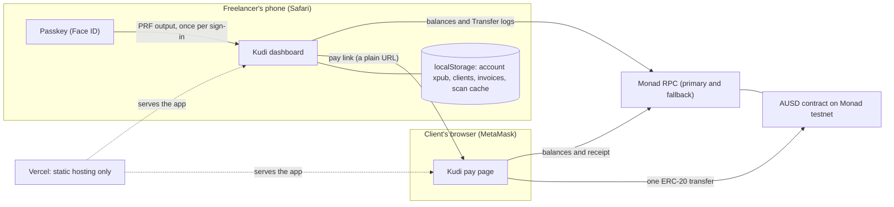

# Kudi

**Get paid from anywhere, in real dollars, with your face.**

Kudi lets a freelancer get paid in dollars from any client with a crypto wallet. The freelancer signs up with a passkey (Face ID or Touch ID), and Kudi derives a separate receiving address for every client from that one passkey. The client opens a pay link and pays in USDC on Arc mainnet or in AUSD on Monad testnet. The freelancer's screen flips to **Paid** with a real transaction hash.

- **Live app:** https://kudi-bholdguy.vercel.app (open it on iPhone Safari to sign up)
- **Code:** https://github.com/Bholdguy/kudi
- **Built for:** Monad Metropolis, Consumer Products & Payments track. Also aimed at the Agora cross-border payments bounty and both Mera bounties.

Kudi has no backend. Everything the freelancer sees comes from the browser and the chain. Freelancers can also send USDC out of their Arc receiving addresses.

## Kudi on Arc

Kudi is live on Arc mainnet with real USDC, alongside Monad testnet.

**Why Arc.** USDC is the gas token, so a client and a freelancer only ever hold dollars. Arc's sub-second finality means the **Paid** screen fires as soon as a payment lands. A client pays in one transaction through `KudiPay`, with no approve step.

**How it works.**

1. The invoice link carries a random 32-byte salt, alongside the freelancer's receiving address and the amount.
2. The client pays `KudiPay.pay(freelancer, salt)` with the amount as native USDC. Arc's native USDC has 18 decimals, so the stored 6-decimal amount is scaled by 10^12.
3. The contract derives `invoiceId = keccak256(abi.encode(freelancer, value, salt))`. An invoice can't be faked with a different amount, and once it is paid it can't be paid again. The contract forwards the funds to the freelancer and emits `InvoicePaid`.
4. Kudi's Paid check reads `paid(invoiceId)` and the `InvoicePaid` log for the transaction hash.
5. The freelancer sends USDC out with Face ID. A Mera passkey-derived key is derived for that one send, used to sign, and wiped. Nothing is stored.

**Contract.** [`0x9ff328491b91a25cfbf6eC9a9e6a6B148476b91F`](https://explorer.arc.io/address/0x9ff328491b91a25cfbf6eC9a9e6a6B148476b91F) on Arc mainnet (chain ID 5042), deployed in [tx `0x18a68407…`](https://explorer.arc.io/tx/0x18a68407b3c7dfc054c4addbd76a390049e2cdac2e8e9506e292400ec9a1a812). **Unverified:** the explorer's verification API blocks automated uploads (it returns a Cloudflare challenge), so the source is not verified on explorer.arc.io. The source is in [`contracts/KudiPay.sol`](contracts/KudiPay.sol).

**Proof on mainnet.** Every `InvoicePaid` event the contract has emitted since deployment (2 at the time of this scan), and every outgoing transfer from the freelancer's receiving address (2, matching its nonce). All rows have status `success`. Times are UTC.

| What it shows | USDC | Block | Time (UTC) | Transaction |
| --- | --- | --- | --- | --- |
| Invoice paid through `KudiPay` (payer `0x87ceb46d…`, freelancer `0xf6a1bcdc…`) | 0.01 | 25955796 | 2026-10-14 17:12:51 | [`0x62c5b80bf1aad4d9affb63e2b386c70b89b873cc922404ad562fc1e9dff11ea2`](https://explorer.arc.io/tx/0x62c5b80bf1aad4d9affb63e2b386c70b89b873cc922404ad562fc1e9dff11ea2) |
| Send from the freelancer's receiving address `0xf6a1bcdc…` to `0x87ceb46d…` | 0.005 | 25959754 | 2026-10-14 17:46:16 | [`0x7f67c256e3a60a6e4fb66c17b612a876027f455b6aaaec2fa6d34e75e1cf9583`](https://explorer.arc.io/tx/0x7f67c256e3a60a6e4fb66c17b612a876027f455b6aaaec2fa6d34e75e1cf9583) |
| Invoice paid through `KudiPay` (payer `0x87ceb46d…`, freelancer `0xf6a1bcdc…`) | 0.02 | 25992459 | 2026-10-14 22:22:26 | [`0x50dc52e5f32ed326caffcc653602706a1ddb206133af5324d50d91808bf4a378`](https://explorer.arc.io/tx/0x50dc52e5f32ed326caffcc653602706a1ddb206133af5324d50d91808bf4a378) |
| Send from the freelancer's receiving address `0xf6a1bcdc…` to `0x87ceb46d…` | 0.01 | 25992801 | 2026-10-14 22:25:19 | [`0x5f9de21828addbd9483c6615a8cee81b59f825601999a5e62359bb13c1c24492`](https://explorer.arc.io/tx/0x5f9de21828addbd9483c6615a8cee81b59f825601999a5e62359bb13c1c24492) |

**Demo video:** [DEMO_VIDEO_URL]

**Live app:** https://kudi-bholdguy.vercel.app

---

## The problem

Freelancers outside the big banking corridors lose money and days on every foreign payment, and crypto feels too risky to use instead. Two pains stack up:

1. **Getting paid across borders is slow and expensive.** Freelancers report losing up to 4% in PayPal conversion and transfer fees ([r/Freelancers](https://www.reddit.com/r/Freelancers/comments/1hy1cyx/paypal_fees_are_bleeding_freelancers_dry_its_time/)), and in some markets about 5% all-in with Payoneer while Wise blocks new sign-ups ([r/PakStartups](https://www.reddit.com/r/PakStartups/comments/1t5i872/pakistani_freelancers_heres_the_honest_2026/)).
2. **The crypto alternative scares people off.** Seed phrases cause near-misses with life savings ([r/CryptoCurrency](https://www.reddit.com/r/CryptoCurrency/comments/1mbvulg/warning_to_trezor_users_if_you_lose_your/)), and normal users fear storing a 24-word phrase at all.

Stablecoin rails fix the first. Passkeys fix the second. Kudi packages both for a freelancer billing a foreign client. (Quotes in the sources are paraphrased.)

## How it works

1. **Create your account.** Tap "Create account" and use Face ID or Touch ID. A passkey creates the account, and there is no password or phrase to write down.
2. **Send a payment link.** Add a client, enter an amount and share the link. Each client gets its own receiving address, derived from the same passkey, so you always know who paid.
3. **Watch it land.** The client pays from MetaMask. Your dashboard marks the invoice Paid within seconds, with a full-screen confirmation and the transaction link.

## Architecture

The diagram shows the Monad testnet path. The Arc path adds `KudiPay` and native USDC balance reads, described in [Kudi on Arc](#kudi-on-arc).



- **No server.** Vercel only serves static files. The only external service in the payment path is the Monad RPC.
- **One passkey, many addresses.** Mera turns the passkey's PRF output into 32 secret bytes. Kudi derives a standard BIP-44 account from them (`m/44'/60'/0'/0/{index}`), stores only the *public* account key, and derives every client address from it without asking for the passkey again. Private material is zeroed after use.
- **The invoice travels in the link.** The pay link carries the receiving address, the amount in base units, the names, a note and the block it was created at. Anything malformed shows "This invoice link is broken" and no pay button.
- **Live receipt.** The dashboard reads AUSD `Transfer` logs to each client address in windows the RPC accepts (it caps `eth_getLogs` at about 100 blocks), recomputes every invoice's status from those transfers, and polls every 1.5 s.

## Real testnet transactions

Read from Monad testnet (chain ID 10143); every row has status `success`. Block times are UTC on 2026-10-13. Links open on [Monadscan](https://testnet.monadscan.com).

| What it shows | AUSD | Block | Time (UTC) | Transaction |
| --- | --- | --- | --- | --- |
| **Kudi pay page:** invoice paid from MetaMask to the freelancer's client address | 50 | 70711401 | 14:58:46 | [`0x7ec422f8…6b01e`](https://testnet.monadscan.com/tx/0x7ec422f8c5fdbbe84a82b85bf533769bc1106071f5f276f116443c8021f6b01e) |
| **Kudi pay page:** second invoice paid while the dashboard was open on a phone | 50 | 70716985 | 15:27:11 | [`0xb0818a0b…020f9`](https://testnet.monadscan.com/tx/0xb0818a0b3034016b1357c9fd1c84b994998eb167b3e2f548a705ad07014020f9) |
| Agora faucet `requestFunds` to a Kudi client address (balance check on the dashboard) | 10,000 | 70701045 | 14:06:12 | [`0x670e58c5…c11dd`](https://testnet.monadscan.com/tx/0x670e58c53bf6dda644e912e52a87e149a12a76eceaa29b9141dc05e7aaec11dd) |
| Agora faucet `requestFunds` to the payer's MetaMask account | 10,000 | 70702112 | 14:11:38 | [`0x21ca027e…88ea6`](https://testnet.monadscan.com/tx/0x21ca027ea696c95c0c82aa68afe3a22c1c9aa464a6963617f69ef19eb3688ea6) |
| Agora faucet `requestFunds` to the payer's MetaMask account | 10,000 | 70707735 | 14:40:10 | [`0x7a15fb0e…b195a`](https://testnet.monadscan.com/tx/0x7a15fb0edcf0094b5ef104894acf72dd8009dfb550101cef0023b70f6b3b195a) |

The two payments each used a gas limit equal to the gas used (55,862), because Kudi passes viem's estimate without padding (Monad charges the declared limit).

## Tech used

- **[Monad](https://monad.xyz) testnet:** the chain. Chain ID 10143, RPC `https://testnet-rpc.monad.xyz` with `https://rpc-testnet.monadinfra.com` as the fallback, Monadscan for receipts.
- **[Mera](https://github.com/category-labs/mera) (`@category-labs/mera`):** passkey accounts through the WebAuthn PRF extension. Kudi uses `createPasskeyWithPrfOutput`, `getPasskeyPrfOutput` and `MeraError` codes, and adds its own BIP-44 derivation on top (Mera ships none).
- **[Agora](https://docs.agora.finance/developer/contract-deployments) AUSD:** the dollar token. Testnet token `0xa9012a055bd4e0eDfF8Ce09f960291C09D5322dC` and the testnet faucet `0xd236c18D274E54FAccC3dd9DDA4b27965a73ee6C`. Kudi only calls the existing AUSD token on Monad testnet.
- **Arc mainnet:** chain ID 5042, native USDC as gas, RPC `https://rpc.mainnet.arc.io`, explorer https://explorer.arc.io. Kudi's own contract is `KudiPay` (see [Kudi on Arc](#kudi-on-arc)), the only contract Kudi wrote.
- **viem**, `@scure/bip32`, `@scure/bip39`, **Next.js** (App Router), **Tailwind CSS**, **Vitest**, and **Vercel** for hosting. Bricolage Grotesque is self-hosted through `@fontsource-variable/bricolage-grotesque`.

## Run it yourself

Needs **Node 24 or newer** (the Mera package requires it; Next.js needs 20.9+ and Vitest 22.12+).

```bash
git clone https://github.com/Bholdguy/kudi.git
cd kudi
npm install
npm run dev
```

Open http://localhost:3000. Passkeys need HTTPS or `localhost` (never `127.0.0.1`), and an authenticator that returns the PRF extension: iPhone Safari on iOS 18+ with iCloud Keychain, or desktop Chrome with a passkey saved to Google Password Manager.

Optional settings go in `.env.local` (see `.env.example`):

| Variable | Purpose |
| --- | --- |
| `NEXT_PUBLIC_RPC_URL` | Primary RPC. Defaults to the public Monad testnet RPC. |
| `NEXT_PUBLIC_RPC_URL_FALLBACK` | Second RPC for the fallback transport. Empty means primary only. |
| `NEXT_PUBLIC_PASSKEY_RP_ID` | Passkey relying party ID. Must equal the hostname the app is served from. Empty means `localhost`. |

These are inlined at build time. A passkey is bound to its `rpId`, so changing the production domain would make existing accounts underivable.

To try a payment you need two things on Monad testnet: AUSD (call `requestFunds(address)` on the faucet above, or use the Agora faucet) and a little MON for gas from https://faucet.monad.xyz. Then create an invoice, open its link in a browser with MetaMask, and pay.

```bash
npm test          # 116 unit tests
npm run lint
npm run build
```

## What was tested

**Automated (116 unit tests, all passing):** passkey-to-address derivation (xpub addresses match the full private derivation and an independent BIP-44 implementation in viem), amount parsing and formatting with bigint (0.01, 50 and 1,000,000 AUSD round-trip), pay-link encode and decode including tampered links, invoice-to-transfer matching (oldest first, short payments add up, overpayment, second payment, shuffled log order), the log-window planner (including a long gap after a phone sleeps), button state and error classification by code, error mapping for passkeys (no PRF, cancelled), the reverted-receipt path, and the activity list.

**Checked against the live chain, read-only:** token symbol and decimals, the faucet's implementation and limits, gas estimates and a transfer simulation, the RPC's log-range limit on both endpoints, and the shipped scan code finding the real 50 AUSD payment above and matching it to an invoice.

**Tested by hand on real devices (by the project owner):** passkey sign-up and sign-in on an iPhone in Safari with the same address both times; per-client addresses and live balances after a faucet call; an invoice shared over WhatsApp and decoded on a PC; two real payments from MetaMask on desktop Chrome (above); the rejected-in-MetaMask and wrong-network messages; and the dashboard flipping to Paid on a phone.

**Tested with stand-ins:** the screens that need a wallet or a payment landing (connect and switch network, "Not enough AUSD", the Paid screen's amounts, Underpaid and extra wording) were exercised in a browser with a throwaway fake wallet that rejects every send, and with synthetic Transfer logs added to real RPC responses. **Account recovery after clearing site data (E16) was tested with mocked chain reads only**, not on a real device.

**Not verified, and known limits**
- First-paint timing (target under 1.5 s on a mid-range phone over 4G) is inconclusive: Lighthouse runs on the landing page ranged from 1.1 s to 3.9 s on the test network; the pay page measured 1.1 s.
- A formal five-run rehearsal log of the full flow on the deployed URL is not included.
- The "browser without PRF" message (desktop Chrome with a local-profile passkey) is covered by unit tests but was not triggered on a real device.
- Invoices and client names live in the browser's storage. Clearing it loses them; client addresses with a balance are rebuilt as "Client 1", "Client 2" and so on after sign-in.
- The recent-payments list only covers clients that have at least one invoice.
- Monad testnet is the free test network. Arc mainnet is live, but only the transactions in [Kudi on Arc](#kudi-on-arc) have been run on it.

## AI tools used

Kudi was built with **Claude Code** (running Claude Sonnet 5.5 in the Claude desktop app). It read the Mera and Agora sources, wrote the code and tests, ran the checks above and deployed, working one phase at a time with the project owner approving each plan and deciding every product question. The visual design followed Anthropic's `frontend-design` skill, and a UX audit used the public data behind [checklist.design](https://www.checklist.design). The agent never sent or approved a payment: every transaction above was made by the project owner from their own MetaMask.

`AGENTS.md` holds the project rules and a decisions log for any agent that works on this repo next.
